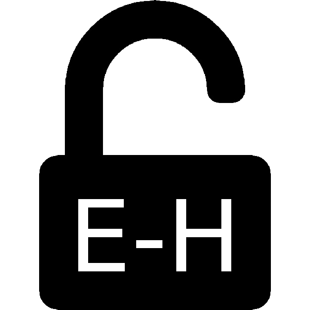

# Unlock Hath Perks

[Install userscript](https://flandredaisuki.github.io/browser-extensions/unlock-hath-perks.user.js)

- [Unlock Hath Perks](#unlock-hath-perks)
  - [解鎖 Hath Perks \[中文\]](#解鎖-hath-perks-中文)
    - [Ads-Be-Gone](#ads-be-gone)
    - [More Thumbs](#more-thumbs)
      - [Comment Panel](#comment-panel)
    - [Paging Enlargement](#paging-enlargement)
    - [Full Width](#full-width)
  - [Unlock Hath Perks \[English\]](#unlock-hath-perks-english)
    - [Ads-Be-Gone](#ads-be-gone-1)
    - [More Thumbs](#more-thumbs-1)
      - [Comment Panel](#comment-panel-1)
    - [Paging Enlargement](#paging-enlargement-1)
    - [Full Width](#full-width-1)

## 解鎖 Hath Perks [中文]

給沒有 Hath 的人用的(模擬的) Hath Perks。僅支援以下瀏覽器：

- 支援 async/await 等語法的瀏覽器

### Ads-Be-Gone

沒什麼特別的，用 `uBlock Origin` 也可以作到差不多效果。

### More Thumbs

打開本本之後可以無限載入。

#### Comment Panel

顯示懸浮面板，讓你暫停縮圖載入並直接閱讀評論。關閉此選項時，會自動載入所有剩餘的縮圖。關閉 More Thumbs 時，此子選項也會停用。

### Paging Enlargement

搜尋結果可以無限載入。

### Full Width

將搜尋結果部份拉到與頁面等寬。

## Unlock Hath Perks [English]

Unlock (Simulate) Hath Perks for who has no hath.

Only support following browsers:

- support async/await syntax

### Ads-Be-Gone

Nothing special, you can use `uBlock Origin` instead.

### More Thumbs

Infinitely load in gallery.

#### Comment Panel

Shows floating controls that pause thumbnail loading and jump to the comments. When it is disabled, all remaining thumbnails load automatically. This sub-option is disabled when More Thumbs is off.

### Paging Enlargement

Infinitely load in search results.

### Full Width

Make search results to fit full width.
